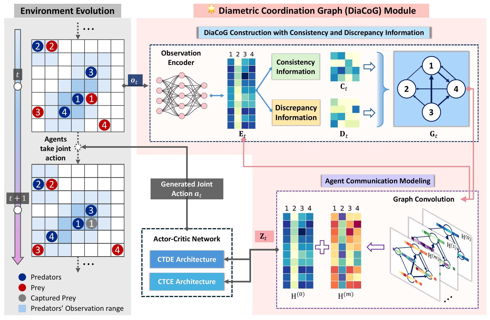

# DiaCoG: Diametric Coordination Graphs for Multi-Agent Reinforcement Learning
Official implementation of the paper *Probing diametric coordination graphs for multi-agent reinforcement learning* — Mutong Liu, Tiantian He, Yang Liu, Jiming Liu, Yew-Soon Ong, *Artificial Intelligence* (2026) ([ScienceDirect](https://www.sciencedirect.com/science/article/pii/S0004370226001293)).

## Overview
**DiaCoG (Diametric Coordination Graph)** integrating two views of agents' observations to model implicit coordination graphs: **consistency** (shared similarities) and **discrepancy** (unique differences). The paper develops two variants, **DiaCoG-DE** under Centralized Training and Decentralized Execution (CTDE) and **DiaCoG-CE** under Centralized Training and Centralized Execution (CTCE).



## Repository contents
1. **DiaCoG** — reference implementation of **DiaCoG-DE** (CTDE) and
   **DiaCoG-CE** (CTCE).
2. **Baselines** — **CENT-MLP**, **DEC-MLP** (MAPPO under CTCE / CTDE) and
   **DICG-CE-MLP**, **DICG-DE-MLP** (DICG under CTCE / CTDE), the four
   comparison methods from our experiments.

---

## Installation
We recommend running the code inside a [`conda`](https://docs.conda.io/projects/conda/en/latest/user-guide/install/) virtual environment. **Python 3.7 is required** — the vendored `garage` fork, `tensorflow==1.15.x` and `ray==0.8.x` do not support newer Python versions.

```bash
conda create -n diacog python=3.7
conda activate diacog
```

Install the dependencies from the repository root. `requirements.txt` lists everything **except** PyTorch, so you can install a torch build that matches your hardware (the code imports only `torch`; `torchvision`/`torchaudio` are not used).

For GPU training (validated on an RTX 4090):

```bash
pip install -r requirements.txt
pip install torch==1.13.1+cu117 --extra-index-url https://download.pytorch.org/whl/cu117
```

For CPU-only training:

```bash
pip install -r requirements.txt
pip install torch
```

Notes:
- `1.13.1+cu117` is the last release line with CUDA 11.7 wheels and supports the RTX 4090 (Ada) architecture; CUDA 12 wheels (e.g. `cu126`) are not available for this torch version.
- TensorFlow is never used for computation in this codebase — it is imported only for global seeding and plotting. The CPU build (`tensorflow==1.15.2`) is sufficient even when training on GPU.
- On Windows, `ray==0.8.x` requires the `curses` module, which is not shipped with Python on Windows:

  ```bash
  pip install windows-curses
  ```

## Environments
- **Predator-Prey** — `envs/predatorprey_wrapper.py`
- **Traffic Junction** — `envs/traffic_junction/`

SMAC is not included in this repository.

---

## DiaCoG

Both DiaCoG variants share the same diametric graph structure and the learned nonlinear value aggregation. They differ in where the graph embeddings `Z` are used, following the CTDE / CTCE split described in the paper:
- **DiaCoG-DE** (CTDE) — the actor acts on its own observation, while the centralized critic uses DiaCoG embeddings.
- **DiaCoG-CE** (CTCE) — both the actor and the critic use the DiaCoG embeddings.
> In the `diacog_*` runners, `--attention_type polarized3`, `--aggregator_type nonl` (and `--critic_input emb` for DiaCoG-CE) are the defaults, so they are omitted from the commands below.

### Predator-Prey

```bash
cd exp_runners/predatorprey/
```

**DiaCoG-DE-MLP**

```bash
python diacog_de_predatorprey_runner.py --penalty P --seed 1
```

**DiaCoG-CE-MLP**

```bash
python diacog_ce_predatorprey_runner.py --penalty P --seed 1
```

To reproduce the other penalty settings, replace `P` with one of `0`, `-1`, `-1.25` or `-1.5`, and use `--seed` `1` to `5` for the averaged runs.

### Traffic Junction

```bash
cd exp_runners/traffic/
```

**DiaCoG-DE-MLP**

```bash
python diacog_de_traffic_runner.py --difficulty D
```

**DiaCoG-CE-MLP**

```bash
python diacog_ce_traffic_runner.py --difficulty D
```

Replace the difficulty `D` with one of `easy`, `medium` or `hard`. See the runner files for the full argument list.

---

## Baselines
Every runner takes a detailed argument list; run with `-h` to see all options (environment size, number of agents, network sizes, PPO hyperparameters, etc.). Model checkpoints and logs are written to `./data/local/` relative to the directory the command is launched from.

### Predator-Prey

```bash
cd exp_runners/predatorprey/
```

| Approach | Command |
|--|--|
| CENT-MLP | `python cent_predatorprey_runner.py --penalty P --seed 1` |
| DEC-MLP | `python dec_predatorprey_runner.py --penalty P --seed 1` |
| DICG-CE-MLP | `python dicg_ce_predatorprey_runner.py --penalty P --seed 1` |
| DICG-DE-MLP | `python dicg_de_predatorprey_runner.py --penalty P --seed 1` |

Replace the penalty `P` with one of `0`, `-1`, `-1.25` or `-1.5`, and use `--seed` `1` to `5` for the averaged runs.

### Traffic Junction

```bash
cd exp_runners/traffic/
```

| Approach | Command |
|--|--|
| CENT-MLP | `python cent_traffic_runner.py --difficulty D --seed 1` |
| DEC-MLP | `python dec_traffic_runner.py --difficulty D --seed 1` |
| DICG-CE-MLP | `python dicg_ce_traffic_runner.py --difficulty D --seed 1` |
| DICG-DE-MLP | `python dicg_de_traffic_runner.py --difficulty D --seed 1` |

Replace the difficulty `D` with one of `easy`, `medium` or `hard`, and use `--seed` `1` to `5` for the averaged runs.

---

## Evaluation modes

Each runner supports several modes through `--mode`:

| Mode | Description |
|--|--|
| `train` (default) | Train from scratch. |
| `restore` | Resume training from the last checkpoint in `--exp_name`. |
| `eval` | Evaluate a saved checkpoint and report returns / success rates. |

Experiment directories are named after the hyperparameters used to launch them, so `--exp_name` must match the directory created at training time.

---

## Citation

```bibtex
@article{liu2026probing,
  title   = {Probing diametric coordination graphs for multi-agent reinforcement learning},
  author  = {Liu, Mutong and He, Tiantian and Liu, Yang and Liu, Jiming and Ong, Yew-Soon},
  journal = {Artificial Intelligence},
  year    = {2026},
  pages   = {104603},
  url     = {https://www.sciencedirect.com/science/article/pii/S0004370226001293}
}
```

## Acknowledgements

This codebase reuses infrastructure from
[parachutel/DICG](https://github.com/parachutel/DICG), which in turn vendors a
fork of [garage](https://github.com/rlworkgroup/garage) (MIT) and adapts the
multi-agent environments from
[ma-gym](https://github.com/koulanurag/ma-gym) (its LICENSE file is Apache-2.0). We thank the authors of these projects.
